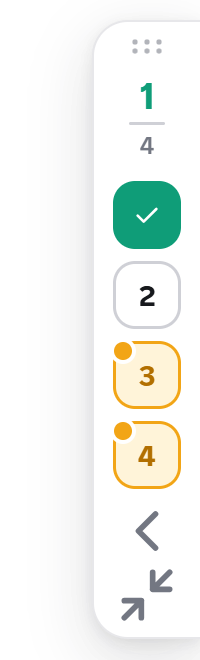
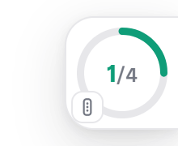
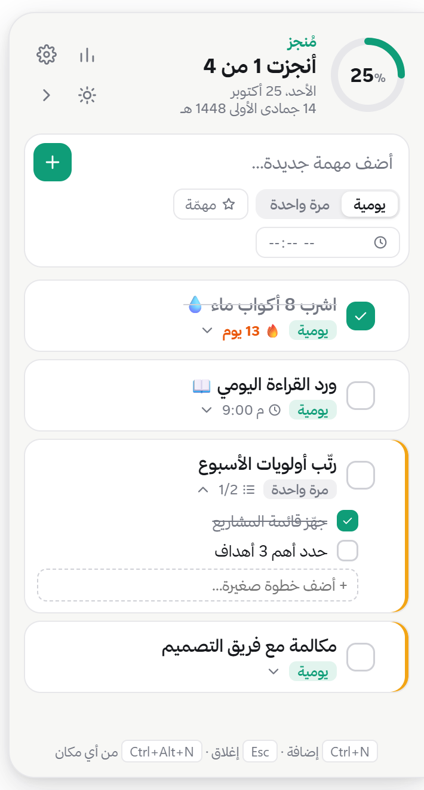
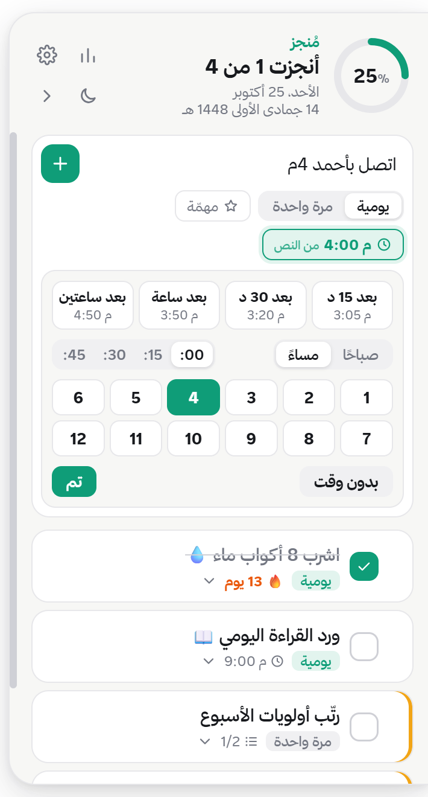
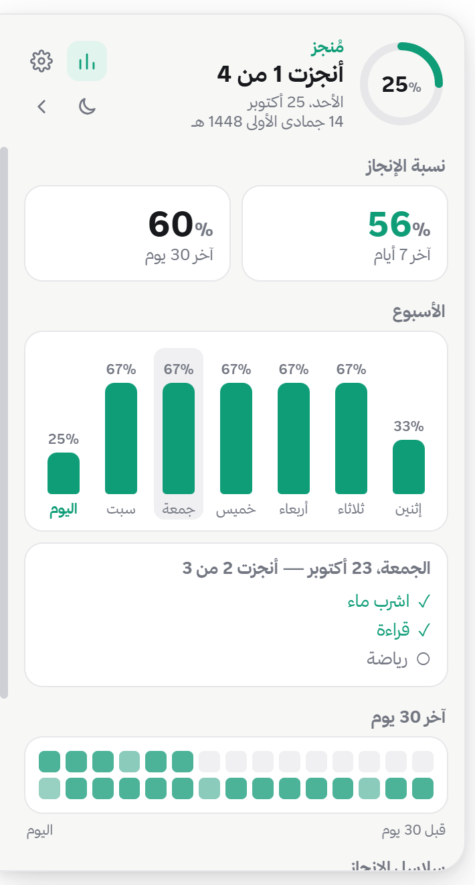

<div dir="rtl">

# مُنجز

شريط مهام عربي صغير ملاصق لحافة شاشة ويندوز، يمين أو يسار. يبقى قدامك فوق كل النوافذ، فتشوف مهام يومك وتنجزها بنقرة وحدة. كل شيء يشتغل على جهازك: بدون إنترنت، بدون حساب، وبدون أي إرسال للبيانات.

<p align="center">
  
  &nbsp;
  
  &nbsp;
  
  &nbsp;
  
  &nbsp;
  
</p>

## المزايا

- **ثلاث أشكال:** شريط طولي فيه رقم لكل مهمة، أو مربع صغير فيه عدد المنجز ودائرة النسبة، أو القائمة الكاملة. تتنقّل بين الشريط والمربع بزر واحد.
- **مهام يومية** تتجدد كل يوم لحالها، و**مهام لمرة واحدة** تبقى لين تنجزها.
- **وقت التذكير بسهولة:**
  - اكتبه مع المهمة نفسها: «اتصل بأحمد 4م»، «اجتماع 9:30 ص»، «ارسل الملف بعد ساعة»، «الساعة 3 مراجعة».
  - أو اختره بنقرات: «بعد 15 د / 30 د / ساعة / ساعتين»، أو صباحًا/مساءً وبعدها الساعة والدقايق.
  - لما يجي الوقت، رقم المهمة يومض ويطلع إشعار من ويندوز.
- **أولوية ⭐**، و**خطوات فرعية** داخل المهمة، و**ترتيب بالسحب**.
- **سلسلة إنجاز 🔥** للمهام اليومية.
- **ملخص نهاية اليوم:** «أنجزت 5 من 6»، مع زر ينقل اللي ما خلص لبكرة.
- **إحصائيات** آخر 7 و30 يوم، وتضغط على أي يوم تشوف سجله.
- **وضع فاتح أو ليلي أو تلقائي**، وخط ثمانية، وأرقام إنجليزية، والتاريخ ميلادي وهجري.
- **اختصارات:** `Ctrl+N` للإضافة (يشتغل والكيبورد عربي)، و`Esc` للإغلاق، و`Ctrl+Alt+N` يفتح الإضافة من أي برنامج (تقدر تغيّره).
- **يشتغل مع ويندوز** تلقائيًا، ونسخة وحدة بس.

---

## التثبيت

### الطريقة الأسهل: ملف التثبيت

1. نزّل **[Munjez-Setup.exe](https://github.com/codefyd/munjez/releases/latest/download/Munjez-Setup.exe)** من آخر إصدار.
2. شغّله. يتثبّت على طول بدون أسئلة، ويشتغل مُنجز ويظهر الشريط على يمين الشاشة.
3. لو طلع لك تحذير **Windows protected your PC**: اضغط **More info** وبعدها **Run anyway**. التحذير يطلع لأن التطبيق غير موقّع رقميًا، مو لأن فيه مشكلة.

تبي نسخة تشتغل بدون تثبيت؟ نزّل **[Munjez-Portable.exe](https://github.com/codefyd/munjez/releases/latest/download/Munjez-Portable.exe)**.

### من الكود المصدري

تحتاج [Node.js](https://nodejs.org) 20 أو أحدث و[Git](https://git-scm.com).

```bash
git clone https://github.com/codefyd/munjez.git
cd munjez
npm install
npm run dist
```

بعدها شغّل `dist\Munjez-Setup.exe`. ولو تبي تجرّبه بدون تثبيت: `npm start`.

## التحديث

بياناتك محفوظة في `%APPDATA%\مُنجز\munjez-data.json`، والتحديث ما يلمسها.

- **إذا ثبّتته من ملف التثبيت:** نزّل [Munjez-Setup.exe](https://github.com/codefyd/munjez/releases/latest/download/Munjez-Setup.exe) من جديد وشغّله. يقفل النسخة القديمة ويركّب الجديدة فوقها.
- **إذا ثبّته من الكود:**

  ```bash
  cd munjez
  git pull
  npm install
  npm run dist
  ```

  وبعدها شغّل `dist\Munjez-Setup.exe`.

## التثبيت والتحديث عن طريق الذكاء الاصطناعي

عندك وكيل ذكاء اصطناعي يقدر يشغّل أوامر على جهازك (مثل Claude Code)؟ انسخ له الأمر المناسب:

### أمر التثبيت

```text
ثبّت لي تطبيق «مُنجز» على ويندوز من https://github.com/codefyd/munjez
نزّل Munjez-Setup.exe من آخر إصدار:
https://github.com/codefyd/munjez/releases/latest/download/Munjez-Setup.exe
احفظه في مجلد التنزيلات، وشغّله، وانتظر لين يخلص التثبيت.
بعدها تأكد إن Munjez.exe شغّال، وإنه مسجّل يشتغل مع ويندوز في
HKCU\Software\Microsoft\Windows\CurrentVersion\Run باسم sa.faris.munjez.
لو ما تسجّل، شغّل التطبيق مرة ثانية من %LOCALAPPDATA%\Programs\munjez\Munjez.exe.
```

### أمر التحديث

```text
حدّث تطبيق «مُنجز» عندي لآخر إصدار من https://github.com/codefyd/munjez
قارن الإصدار المثبّت (من خصائص الملف %LOCALAPPDATA%\Programs\munjez\Munjez.exe)
بآخر إصدار في صفحة Releases. إذا فيه أحدث:
نزّل https://github.com/codefyd/munjez/releases/latest/download/Munjez-Setup.exe
وشغّله. لا تحذف ولا تعدّل مجلد %APPDATA%\مُنجز لأن فيه بياناتي.
بعدها تأكد إن مُنجز شغّال، وإن الإصدار صار الجديد.
```

### أمر التثبيت من الكود (للمطوّرين)

```text
استنسخ https://github.com/codefyd/munjez وثبّت الحزم بـ npm install،
وابنِ ملف التثبيت بـ npm run dist، وشغّل dist\Munjez-Setup.exe.
تأكد إن Node.js 20 أو أحدث موجود قبل ما تبدأ.
```

---

## للمطوّرين

```text
src/main.js      العملية الرئيسية: النافذة، الأيقونة جنب الساعة، الاختصار العام، الحفظ
src/preload.js   الجسر بين الواجهة والعملية الرئيسية
src/app.js       الواجهة كاملة: الشريط، القائمة، الإحصائيات، الإعدادات، اختيار الوقت
src/styles.css   التصميم والوضع الفاتح والليلي
scripts/         توليد الأيقونة
```

- النافذة شفافة وتغطي ارتفاع الشاشة على الحافة. النقرات تعبر منها لأي برنامج تحتها، إلا فوق عناصر مُنجز نفسه.
- عشان تجرّب بدون ما تلمس بياناتك:

  ```bash
  npx electron . --data-dir=<مجلد> --panel --snap=out.png --exit
  ```

  هذا الأمر يشغّل مُنجز ببيانات منفصلة، ويفتح القائمة، ويحفظ لقطة شاشة. وتقدر تضيف `--run=script.js` ينفّذ سكربت قبل اللقطة.

## الترخيص

الكود مفتوح المصدر بترخيص [MIT](LICENSE). خط «ثمانية» ملك لثمانية، ومستخدم حسب [ترخيصه](https://font.thmanyah.com/licenses).

</div>
